  <picture>
    <source media="(max-width: 1100px)" srcset="./assets/mehdi-signal-compact.svg" />
    
  </picture>
   
  

    &nbsp;
    &nbsp;
    
    
  

## Building interfaces people rely on.

I’m **Mehdi Rafiei**, a senior front-end developer with **8+ years** building production products across fintech, crypto, e-commerce, and real estate. I specialize in **Vue/Nuxt** and **React/Next.js** with TypeScript, shaping complex product needs into fast, intuitive interfaces.

I work across API integration, real-time data, testing, and delivery, bringing product UI and system constraints together.

### Supporting toolkit

**UI & testing:** Tailwind CSS, UnoCSS, SCSS, Vitest, Cypress, Jest 
**Product engineering:** REST APIs, WebSockets, Server-Sent Events, performance, accessibility, i18n

### Selected work

| Project | What it shows |
| --- | --- |
| [Personal website](https://github.com/mehdicodespace/personal-website-nuxt) | Nuxt 3 · Vue 3 · portfolio, galleries, and technical blog |
| [Countries Explorer](https://github.com/mehdicodespace/countries-explorer) | Vue 3 · TypeScript · tested search and filtering |
| [Customer Registry](https://github.com/mehdicodespace/customer-registry-web) | Vue 3 · Firebase Auth · scoped data and theme switching |
| [CSS Orbit Animation](https://github.com/mehdicodespace/css-circular-orbit-animation) | CSS-only orbital animation for technology icons |

My production work applies the same focus to fintech, trading, and consumer products. [Explore more projects →](https://mehdispace.com/portfolios)

### Engineering highlights

- **Real-time trading:** WebSockets, Server-Sent Events, and request caching for live market data.
- **Complex product flows:** multilingual experiences, video KYC, PWA payments, and transaction features.
- **Production delivery:** performance and SEO improvements, testing strategy, export pipelines, and Capacitor releases.
